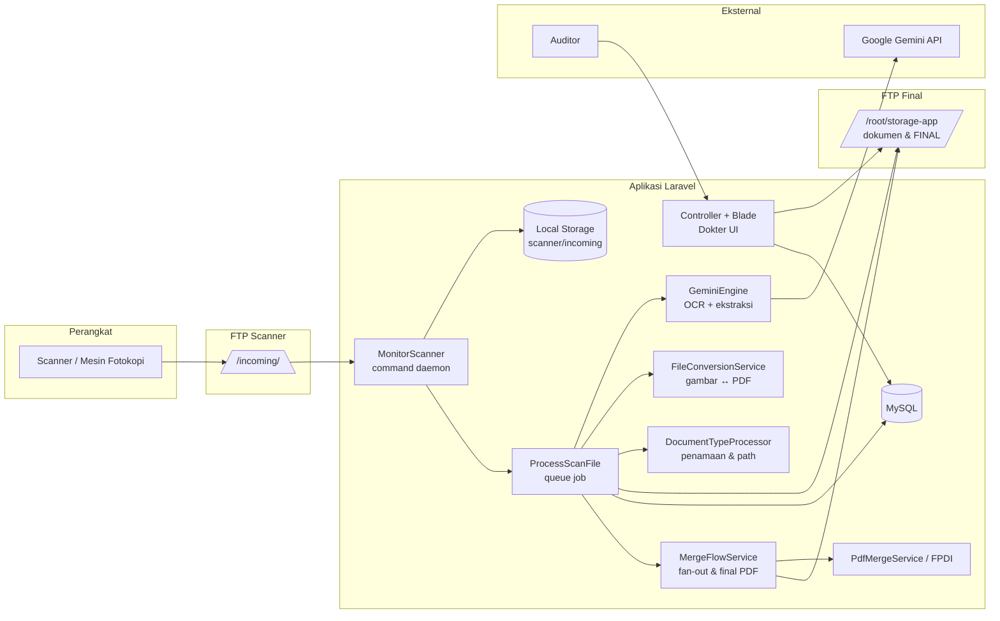
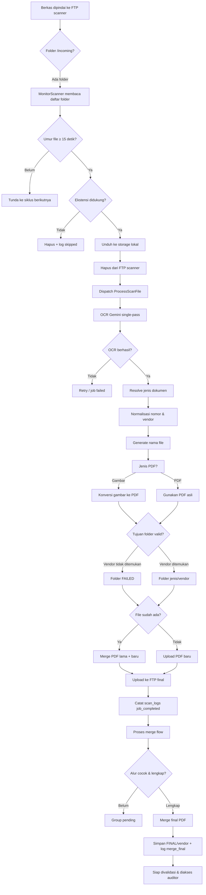
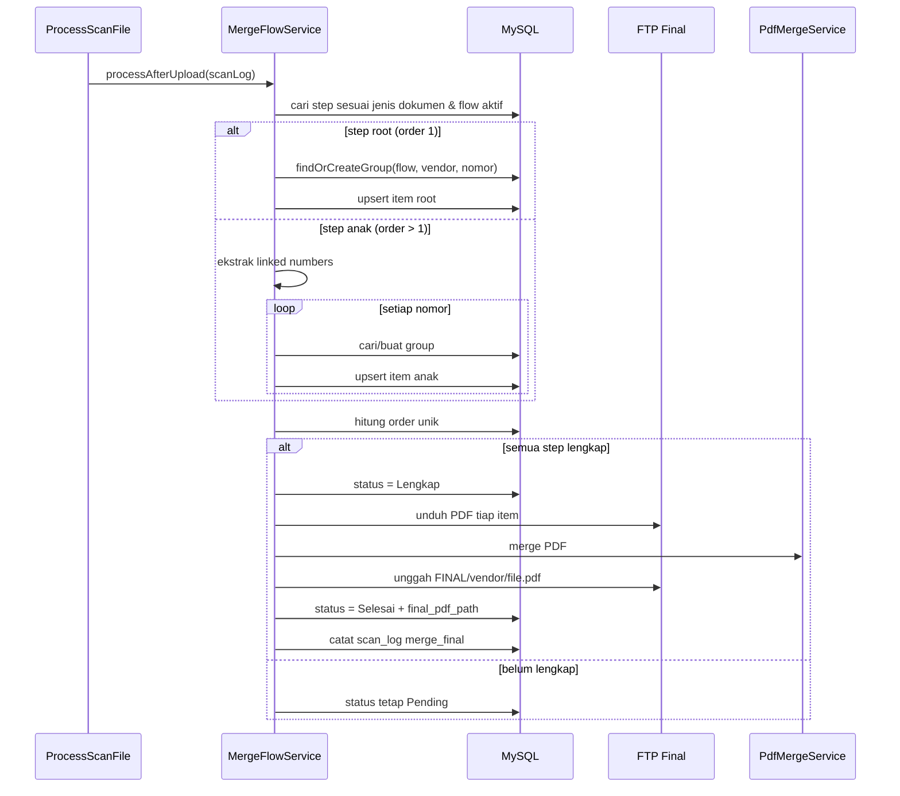
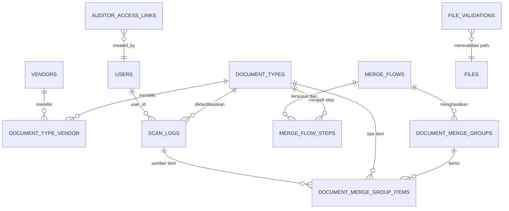

# Gambaran Umum Modul Dokter (Dokumen Kontroler)

> Dokumen ini disusun sebagai bahan **Bab Gambaran Umum** untuk laporan Kerja Praktik.
> Isi diambil dari analisis langsung terhadap kode sumber, migrasi basis data, konfigurasi,
> route, tampilan, dan pengujian pada repositori `app-moki`.

| Atribut | Keterangan |
|---|---|
| Nama aplikasi | Portal Aplikasi Internal SBS |
| Nama modul | **Dokter** (nama tampilan: **Dokumen Kontroler**) |
| Jenis modul | Document Management System (DMS) berbasis pemindaian dan OCR |
| Namespace route | `dokter.*` |
| Namespace permission | `dokter.*` |
| Namespace controller | `App\Http\Controllers\Dokter` |
| Perintah utama | `php artisan app:monitor-scanner` |
| Repositori | `app-moki` |
| Stack utama | Laravel 8, PHP 8, MySQL, jQuery, Bootstrap 5, Gemini API, FTP |
| Status | Berjalan; sebagian fitur masih berupa pengembangan lanjutan |

---

## Daftar Isi

1. [Ringkasan Eksekutif](#1-ringkasan-eksekutif)
2. [Identitas dan Posisi Modul](#2-identitas-dan-posisi-modul)
3. [Latar Belakang dan Tujuan](#3-latar-belakang-dan-tujuan)
4. [Ruang Lingkup](#4-ruang-lingkup)
5. [Aktor dan Hak Akses](#5-aktor-dan-hak-akses)
6. [Arsitektur Sistem](#6-arsitektur-sistem)
7. [Alur Bisnis End-to-End](#7-alur-bisnis-end-to-end)
8. [Fitur per Menu](#8-fitur-per-menu)
9. [Model Data](#9-model-data)
10. [Detail Teknis Implementasi](#10-detail-teknis-implementasi)
11. [Keamanan](#11-keamanan)
12. [Konfigurasi dan Deployment](#12-konfigurasi-dan-deployment)
13. [Pengujian](#13-pengujian)
14. [Temuan Teknis dan Rekomendasi](#14-temuan-teknis-dan-rekomendasi)
15. [Kesimpulan](#15-kesimpulan)
16. [Lampiran](#16-lampiran)

---

## 1. Ringkasan Eksekutif

**Dokter** adalah modul **Dokumen Kontroler** pada portal aplikasi internal SBS. Modul ini
mengotomasi rantai kerja pengelolaan dokumen keuangan: berkas fisik dipindai (scan) ke folder
FTP, dibaca oleh OCR berbasis AI (Google Gemini), diklasifikasikan berdasarkan jenis dokumen,
diberi nama sesuai pola yang dapat dikonfigurasi, diunggah ke penyimpanan FTP final, lalu
digabungkan otomatis mengikuti **alur birokrasi** antarjenis dokumen. Hasil akhirnya dapat
divalidasi oleh operator dan dibuka secara **read-only** oleh auditor melalui tautan khusus.

Secara garis besar, modul ini menjawab empat masalah operasional:

1. **Penamaan dan penempatan berkas yang konsisten** — nama file dan folder dibentuk dari
   hasil OCR menggunakan template, bukan diketik manual.
2. **Penggabungan dokumen yang saling terkait** — misalnya *Slip Pembukuan AP* (invoice) dan
   *Persetujuan Pembayaran* digabung menjadi satu PDF final per invoice.
3. **Ketertelusuran (audit trail)** — setiap aktivitas pemrosesan dicatat pada tabel
   `scan_logs`, dapat difilter dan diekspor ke Excel.
4. **Akses auditor tanpa akun internal** — auditor eksternal cukup memakai tautan bertoken
   dengan pembatasan tahun.

Angka penting modul:

| Indikator | Nilai |
|---|---|
| Controller modul | 9 controller (1 di antaranya masih kosong) |
| Route internal | 33 route |
| Route publik auditor | 3 route |
| Permission | 20 permission |
| Tabel utama | 10 tabel (termasuk tabel pivot dan tabel pendukung) |
| Halaman Blade | 15 halaman |
| Berkas pengujian | 7 berkas (unit dan feature) |
| Jenis dokumen awal (seeder) | 5 jenis |
| Alur birokrasi awal (seeder) | 2 alur (legacy dan invoice–approval) |
| Format berkas masuk | PNG, JPG, JPEG, WEBP, PDF |

Kekuatan utama implementasi ini adalah **pemisahan tanggung jawab yang jelas** antara proses
masuk berkas (command), pemrosesan OCR (job), aturan penamaan (model/service), penggabungan
(service), dan penyajian (controller/view). Kelemahan utamanya terletak pada beberapa
**inkonsistensi integrasi dan konfigurasi akses**, yang dirangkum pada
[Bagian 14](#14-temuan-teknis-dan-rekomendasi).

---

## 2. Identitas dan Posisi Modul

### 2.1 Nama dan Istilah

Nama **"Dokter"** bukan merujuk pada profesi medis. Di lingkungan aplikasi ini, "Dokter"
adalah nama internal modul, dengan nama tampilan **Dokumen Kontroler** (terlihat pada
dashboard dan kartu portal). Istilah ini dipakai konsisten pada:

- prefix URL: `/dokter/...`
- nama permission: `dokter.*`
- namespace controller: `App\Http\Controllers\Dokter`
- folder view: `resources/views/dokter`
- perintah console: `app:monitor-scanner` dengan namespace `App\Console\Commands\Dokter`

### 2.2 Posisi dalam Portal

Modul Dokter terdaftar sebagai salah satu kartu pada halaman portal (`PortalController`),
berdampingan dengan IT Admin, AMS, Helpdesk, Form IT, EQTAX, E-RKAP, dan SIMKA.

| Aspek | Implementasi |
|---|---|
| Autentikasi | Middleware `auth` global portal |
| Otorisasi menu | Middleware `permission:dokter.menu` pada seluruh route group |
| Otorisasi aksi | Middleware permission per route (view/create/edit/delete/validate/export) |
| Single Sign-On | Tersedia melalui Microsoft Entra ID di level portal; role default SSO sengaja dikosongkan |
| Kembali ke portal | Menu "Back to Portal" pada sidebar |

Dengan pola ini, modul Dokter **tidak berdiri sendiri** sebagai aplikasi terpisah, melainkan
terintegrasi ke dalam satu portal dengan satu mekanisme login dan satu model RBAC
(role-based access control).

### 2.3 Riwayat Pengembangan (dari riwayat Git)

| Tanggal | Peristiwa |
|---|---|
| 30 Jul 2026 | Modul Dokter dimigrasikan menjadi bagian dari aplikasi portal |
| 31 Jul 2026 | Kerangka awal scan log dan integrasi pemindaian |
| 2–4 Agu 2026 | Ekstraksi keterangan, tanggal, uraian; merge flow pertama |
| 7 Agu 2026 | Fitur akses auditor |
| 12–13 Agu 2026 | Migrasi mesin OCR dari OCR.space ke Google Gemini API |
| 20 Okt 2026 | Penyempurnaan merge flow invoice + persetujuan (fan-out) |
| 26 Okt 2026 | Pengujian integrasi |
| 28 Okt 2026 | Integrasi autentikasi perangkat scanner (folder scanner) |
| 2 Nov 2026 | Monitor scanner diubah menjadi proses looping |

Riwayat ini menunjukkan evolusi bertahap: dari sekadar **penyimpanan berkas hasil scan**,
menjadi **pipeline OCR + klasifikasi + penamaan + penggabungan + audit**.

---

## 3. Latar Belakang dan Tujuan

### 3.1 Latar Belakang

Sebelum modul ini ada, pengelolaan dokumen keuangan (invoice, slip pembukuan, berita acara,
persetujuan pembayaran) dilakukan secara manual:

- berkas hasil scan diberi nama dan dipindahkan ke folder secara manual;
- dokumen yang saling terkait disatukan secara manual menjadi satu PDF;
- pengecekan kelengkapan dokumen dilakukan dengan menelusuri folder;
- auditor meminta salinan berkas dan harus dilayani secara manual;
- tidak ada catatan sistematis tentang siapa memproses berkas, kapan, dan hasilnya.

Pola tersebut rawan terhadap:

- salah nama, salah folder, dan duplikasi berkas;
- dokumen tercecer atau tidak lengkap;
- waktu tunggu audit yang lama;
- kesulitan menelusuri kembali riwayat pemrosesan.

Modul Dokter hadir untuk **mengotomasi sedapat mungkin** proses tersebut, dengan manusia
berperan pada tahap validasi dan pengawasan.

### 3.2 Tujuan Fungsional

1. Menangkap berkas hasil pemindaian dari perangkat scanner melalui FTP.
2. Membaca isi dokumen menggunakan OCR dan mengekstrak data kunci:
   jenis dokumen, nomor dokumen, tanggal, vendor, keterangan, uraian, nomor PO, dan daftar
   nomor invoice.
3. Mengklasifikasikan dokumen ke jenis yang sesuai.
4. Memberi nama berkas dan folder secara otomatis berdasarkan template.
5. Mengonversi gambar hasil scan menjadi PDF.
6. Menggabungkan berkas PDF yang memiliki nama sama (hasil scan berulang).
7. Menggabungkan dokumen lintas jenis mengikuti alur birokrasi.
8. Menyimpan hasil akhir pada FTP final yang tertata.
9. Menyediakan validasi berkas oleh operator.
10. Menyediakan akses read-only bagi auditor melalui tautan bertoken.
11. Mencatat seluruh aktivitas pemrosesan dalam log yang dapat difilter dan diekspor.

### 3.3 Tujuan Non-Fungsional

| Aspek | Target/Implementasi |
|---|---|
| Konsistensi | Nama file/folder mengikuti template dan sanitasi karakter |
| Ketertelusuran | `scan_logs` merekam event, status, waktu, user, path, ukuran, durasi proses |
| Ketahanan | Retry OCR dan upload FTP; file scanner yang belum selesai diunggah ditunda |
| Idempotensi | Scan ulang tidak menimpa PDF final yang sudah selesai |
| Kinerja OCR | Hanya halaman pertama PDF yang dikirim; gambar diperkecil; model cadangan |
| Keamanan | RBAC, token 64 karakter, pembatasan tahun, larangan unduh untuk auditor |
| Pemeliharaan | Pemisahan command, job, service, model, controller, dan view |

---

## 4. Ruang Lingkup

### 4.1 Termasuk dalam Ruang Lingkup

- Pemantauan folder FTP scanner secara berkala.
- OCR dan ekstraksi data terstruktur.
- Klasifikasi jenis dokumen.
- Penamaan dan penempatan berkas pada FTP final.
- Konversi gambar ke PDF dan penggabungan PDF.
- Konfigurasi jenis dokumen, vendor, dan alur birokrasi.
- Validasi berkas.
- Log aktivitas dan ekspor Excel.
- Manajemen tautan akses auditor.
- Tampilan baca-saja untuk auditor.

### 4.2 Di Luar Ruang Lingkup

- Pemindaian fisik (dilakukan oleh perangkat scanner, bukan aplikasi).
- Pengelolaan perangkat keras scanner.
- Akuntansi, pajak, atau proses pembayaran itu sendiri.
- Aplikasi mobile khusus scanner.
- Penghapusan atau pengubahan berkas asli hasil scan.
- Backfill otomatis seluruh data lama ke alur baru.
- Manajemen pengguna scanner yang lengkap (baru sebagian).

---

## 5. Aktor dan Hak Akses

### 5.1 Aktor

| Aktor | Peran |
|---|---|
| **Super Admin** | Memiliki seluruh permission, termasuk konfigurasi alur birokrasi |
| **Admin** | Mengelola master data, memvalidasi berkas, melihat log, membuat tautan auditor |
| **Staff/Operator** | Melihat dan mengunduh berkas, memvalidasi berkas |
| **Auditor Eksternal** | Membuka tautan publik, melihat PDF sesuai tahun yang diizinkan, tidak dapat mengunduh |
| **Sistem (daemon)** | `app:monitor-scanner` memantau FTP dan mengirim job OCR |
| **Sistem (queue worker)** | Menjalankan `ProcessScanFile` dan merge flow |

### 5.2 Matriks Permission

Modul mendefinisikan **20 permission**:

| Grup | Permission |
|---|---|
| Menu & dashboard | `dokter.menu`, `dokter.dashboard` |
| Vendor | `dokter.vendors.view`, `.create`, `.edit`, `.delete` |
| Jenis dokumen | `dokter.document-types.view`, `.create`, `.edit`, `.delete` |
| File management | `dokter.file-managements.view`, `.download`, `.validate` |
| Log file | `dokter.log-file.view`, `.export` |
| Alur birokrasi | `dokter.merge-flows.view`, `.create`, `.edit`, `.delete` |
| Akses auditor | `dokter.auditor-access.manage` |

### 5.3 Pemetaan Role (sesuai seeder)

| Role | Hak yang diberikan |
|---|---|
| `super-admin` | Seluruh permission (`syncPermissions($allPermissions)`) |
| `admin` | Hampir seluruh permission Dokter, **kecuali** `merge-flows.*` |
| `staff` | `dokter.menu`, `dokter.dashboard`, file management view/download/validate |
| `dokter-admin` | Tidak ada permission (kosong) |
| `dokter-user` | Tidak ada permission (tidak digunakan) |

> **Catatan:** ketidaksesuaian pemberian permission ini dibahas pada
> [Bagian 14](#14-temuan-teknis-dan-rekomendasi).

### 5.4 Mekanisme Otorisasi

Otorisasi memakai **Spatie Laravel Permission**:

- Route group utama dilindungi `permission:dokter.menu`.
- Setiap aksi dilindungi permission spesifik.
- Tampilan juga memeriksa permission, misalnya checkbox validasi hanya muncul jika pengguna
  memiliki `dokter.file-managements.validate`.
- Tombol ekspor Excel hanya muncul dengan `dokter.log-file.export`.

Pola ini menerapkan **defense in depth**: pembatasan di route dan di tampilan.

---

## 6. Arsitektur Sistem

### 6.1 Diagram Komponen



### 6.2 Stack Teknologi

| Lapisan | Teknologi | Fungsi |
|---|---|---|
| Bahasa | PHP 8 | Implementasi backend |
| Framework | Laravel 8.75 | Routing, ORM, queue, storage, validasi |
| Basis data | MySQL | Data master, log, grup merge, validasi, tautan auditor |
| Frontend | Blade, Bootstrap 5, jQuery, Skote Admin | Tampilan operator dan auditor |
| Ikon | Material Design Icons, Boxicons | Ikon antarmuka |
| PDF viewer | PDF.js (komponen kustom) | Pratinjau PDF di modal |
| OCR | Google Gemini API (`generateContent`) | Ekstraksi teks dan data terstruktur |
| Konversi gambar | Imagick, fallback GD | Gambar ke PDF |
| Manipulasi PDF | FPDI/FPDF (`setasign/fpdi`) | Merge PDF, potong halaman, hitung halaman |
| Excel | `maatwebsite/excel` + PhpSpreadsheet | Ekspor log |
| RBAC | `spatie/laravel-permission` | Role dan permission |
| Penyimpanan | Laravel FTP filesystem (`ftp`, `ftp_final`) | Baca scanner, tulis hasil akhir |
| Autentikasi portal | Session + Microsoft Entra ID (opsional) | Login pengguna internal |

### 6.3 Lapisan Aplikasi

| Lapisan | Lokasi | Contoh |
|---|---|---|
| Route | `routes/routers/dokter.php`, `routes/web.php` | Route internal dan publik auditor |
| Controller | `app/Http/Controllers/Dokter` | `FileManagementController`, `MergeFlowController` |
| Request validation | `app/Http/Requests` | `StoreDocumentTypeRequest`, `StoreVendorRequest` |
| Service | `app/Services` | `MergeFlowService`, `GeminiEngine`, `PdfMergeService` |
| Job | `app/Jobs/ProcessScanFile.php` | Pipeline OCR dan upload |
| Command | `app/Console/Commands/Dokter/MonitorScanner.php` | Pemantau FTP |
| Model | `app/Models` | `ScanLog`, `DocumentType`, `MergeFlow`, dll. |
| View | `resources/views/dokter`, `resources/views/auditor` | UI operator dan auditor |
| Export | `app/Exports/ScanLogsExport.php` | Laporan Excel |
| Config | `config/filesystems.php`, `config/services.php` | FTP, Gemini, konversi file |

### 6.4 Pola Arsitektur

Modul ini menerapkan pola **pipeline processing**:

```text
Sumber berkas → deteksi → OCR → normalisasi data → penentuan tujuan
→ konversi/merge → unggah → pencatatan → penggabungan lintas dokumen
```

Tanggung jawab dipisahkan sebagai berikut:

- **Command** hanya memantau dan memindahkan berkas ke storage lokal.
- **Job** menjalankan orkestrasi pemrosesan satu berkas.
- **Service** menangani algoritma spesifik (OCR, konversi, merge, sanitasi).
- **Model** menyimpan relasi dan aturan tampilan status.
- **Controller** hanya menyajikan data dan menerima aksi pengguna.

Pemisahan ini memudahkan pengujian unit pada service dan feature test pada alur.

---

## 7. Alur Bisnis End-to-End

### 7.1 Diagram Alur Utama



### 7.2 Tahap 0 — Penangkapan Berkas oleh Scanner

Perangkat scanner mengunggah berkas ke FTP scanner pada direktori akar `/incoming`.
Struktur yang diharapkan:

```text
/incoming/
├── <nama-folder-pengguna>/
│   ├── scan-001.jpg
│   └── scan-002.pdf
└── <slug-jenis-dokumen>/
    └── scan-003.jpg
```

Aplikasi menerima format:

| Ekstensi | Perlakuan |
|---|---|
| `png`, `jpg`, `jpeg`, `webp` | Dikonversi ke PDF sebelum diunggah |
| `pdf` | Diproses/dipertahankan sebagai PDF |

Ekstensi lain akan dihapus dari FTP scanner dan dicatat sebagai `file_skipped`.

### 7.3 Tahap 1 — Monitor Scanner

**Komponen:** `app/Console/Commands/Dokter/MonitorScanner.php`
**Signature:** `app:monitor-scanner`
**Scheduler:** `everyMinute()` pada `app/Console/Kernel.php`

Perilaku utama:

1. Memastikan minimal ada satu `DocumentType`; jika tidak, command berhenti.
2. Melakukan loop tanpa henti dengan interval 10 detik.
3. Membaca seluruh direktori di bawah `/incoming`.
4. Untuk setiap folder, membaca berkas langsung di dalamnya.
5. Menunda berkas yang usianya kurang dari **15 detik** (`SCANNER_MIN_FILE_AGE`), untuk
   menghindari membaca berkas yang masih dikunci FTP server saat proses unggah scanner.
6. Mengunduh isi berkas, menyimpannya ke `storage/app/private/scanner/incoming/`, lalu
   menghapusnya dari FTP scanner.
7. Mengirim `ProcessScanFile` ke queue.

Ada dua jalur pemrosesan:

| Jalur | Perilaku |
|---|---|
| Folder dianggap folder pengguna | Nama folder dikirim sebagai `user` |
| Folder dianggap jenis dokumen | Folder dicocokkan dengan `document_types.slug` |

> Catatan: kedua jalur membaca direktori yang sama. Karena berkas dihapus setelah jalur
> pertama selesai, jalur kedua umumnya tidak menemukan berkas lagi. Detail dan risikonya
> dibahas pada [Bagian 14](#14-temuan-teknis-dan-rekomendasi).

### 7.4 Tahap 2 — OCR dan Ekstraksi Data

**Komponen:** `app/Jobs/ProcessScanFile.php`, `app/Services/Ocr/GeminiEngine.php`

Alur:

1. Job membaca berkas dari storage lokal.
2. Berkas dibungkus sebagai `UploadedFile`.
3. `GeminiEngine::extractText()` dipanggil **satu kali** untuk mendapatkan jenis dokumen dan
   seluruh field sekaligus (**single-pass**).
4. Respons JSON Gemini diparse dan dinormalisasi.
5. Data yang diekstrak:

| Field | Keterangan |
|---|---|
| `document_type` | Jenis dokumen (judul dokumen) |
| `document_number` | Nomor dokumen utama |
| `document_date` | Tanggal dokumen, format `DD Mon YY` |
| `vendor_name` | Nama vendor/perusahaan |
| `customer` | Nama pelanggan |
| `keterangan` | Keterangan dokumen |
| `uraian` | Daftar uraian (array string) |
| `no_po` | Nomor PO yang diambil dari keterangan |
| `invoice_numbers` | Daftar nomor invoice (khusus Persetujuan Pembayaran) |

6. Jika `document_type` mengandung kata **PERSETUJUAN** dan PDF memiliki lebih dari satu
   halaman, sistem menjalankan **pass kedua** pada seluruh halaman untuk menangkap seluruh
   `invoice_numbers`, lalu menggabungkan hasilnya.
7. Hasil OCR disimpan juga sebagai berkas JSON di
   `storage/app/private/scanner/ocr-results/<nama-file>.json`.

**Strategi optimasi OCR yang terlihat pada kode:**

- Hanya **halaman pertama** PDF yang dikirim ke Gemini (`GEMINI_PDF_OCR_PAGES=1`).
- Gambar diperkecil ke lebar maksimum **1024 px** dan kualitas **85**.
- `mediaResolution = low` dan `thinkingLevel = minimal`.
- `temperature = 0.1` dan output dipaksa `application/json`.
- `maxOutputTokens = 1024`.
- Jeda antarrequest **100 ms**, batch size **5**, jeda antarbatch **500 ms**.
- Retry hingga **3 kali** untuk status 429/500/502/503/504, dengan backoff eksponensial.
- Model cadangan dapat dikonfigurasi melalui `GEMINI_FALLBACK_MODELS`.

### 7.5 Tahap 3 — Normalisasi dan Penamaan Berkas

**Komponen:** `DocumentTypeProcessor`, `DocumentType`, `FileNameSanitizer`,
`InvoiceNumberNormalizer`

Aturan:

1. Nomor dokumen dan nomor PO dibersihkan dari karakter yang tidak aman.
2. Pemisah path (`/` dan `\`) diubah menjadi `_` agar nomor seperti
   `001/PBT/M/03/26` tidak membentuk folder baru.
3. Nama file dibentuk dari `filename_template` milik jenis dokumen.
4. Placeholder yang didukung:

| Placeholder | Sumber |
|---|---|
| `{vendor}` | Nama vendor hasil OCR (huruf besar) |
| `{number}` | Nomor dokumen |
| `{no_po}` | Nomor PO |
| `{ext}` | Ekstensi |
| `{filename}` | Nama file asli |

5. Jika template belum memuat `{no_po}`, nomor PO otomatis ditambahkan sebelum ekstensi.
6. Folder tujuan dibentuk dari `ftp_folder_template`, dengan placeholder:

| Placeholder | Sumber |
|---|---|
| `{document_type}` | Nama jenis dokumen |
| `{vendor}` | Nama vendor |
| `{number}` | Nomor dokumen |
| `{filename}` | Nama file |

7. Jika vendor tidak ditemukan **dan** jenis dokumen mewajibkan pencarian vendor, berkas
   diarahkan ke folder `FAILED` (`ftp_failed_folder`).

Contoh konfigurasi awal:

| Jenis Dokumen | Filename Template | Folder Template |
|---|---|---|
| SLIP PEMBUKUAN AP | `{vendor}_{number}.{ext}` | `{document_type}/{vendor}` |
| INVOICE | `INV_{vendor}_{number}.{ext}` | `{document_type}/{vendor}` |
| BERITA ACARA | `BA_{vendor}_{number}.{ext}` | `{document_type}/{vendor}` |
| PEMBAYARAN | `SP_{vendor}_{number}.{ext}` | `{document_type}/{vendor}` |
| PERSETUJUAN PEMBAYARAN | `APP_{vendor}_{number}.{ext}` | `{document_type}/{vendor}` |

### 7.6 Tahap 4 — Konversi, Merge Duplikat, dan Unggah FTP Final

1. Jika berkas berupa gambar, `FileConversionService` mengonversinya ke PDF.
   - Prioritas: **Imagick**.
   - Fallback: **GD** (membentuk PDF sederhana dari JPEG).
2. Jika file tujuan **sudah ada** di FTP final, sistem mengunduh file lama, menggabungkannya
   dengan file baru (PDF lama + PDF baru), lalu mengunggah hasil gabungan.
   - Jika merge gagal, file baru tetap diunggah dan status merge dicatat `merge_failed`.
3. Upload dilakukan maksimal **3 percobaan**, dengan jeda 5 detik dan koneksi FTP
   di-reset di antara percobaan.
4. Setelah berhasil, berkas lokal dihapus.
5. `scan_logs` mencatat event `job_completed` dengan status `success`, termasuk:
   nama file, jenis dokumen, nomor dokumen, vendor, tanggal, keterangan, nomor PO, uraian,
   path FTP, ukuran, durasi proses, status merge, jumlah halaman, dan teks OCR.
6. Metadata OCR lengkap disimpan pada `scan_logs.metadata.ocr_data`.

### 7.7 Tahap 5 — Alur Birokrasi (Merge Flow)

**Komponen:** `app/Services/MergeFlowService.php`

#### 7.7.1 Konsep

Alur birokrasi adalah rangkaian **step** dokumen yang saling terkait. Setiap step mengacu
pada satu jenis dokumen dan memiliki urutan (`order`).

Contoh alur **INV–APPROVAL**:

| Order | Jenis Dokumen | Peran |
|---|---|---|
| 1 | SLIP PEMBUKUAN AP | Dokumen root (invoice) |
| 2 | PERSETUJUAN PEMBAYARAN | Dokumen anak (approval) |

#### 7.7.2 Pembentukan Grup

- Grup diidentifikasi oleh kombinasi:
  - `merge_flow_id`
  - `vendor_name` (dinormalisasi)
  - `root_document_number` (nomor invoice, dinormalisasi)
- Dokumen step 1 (root) membuat grup.
- Dokumen step >1 (anak) mengekstrak nomor induk dari:
  1. `link_field` pada `metadata.ocr_data` (misalnya `invoice_numbers`),
  2. `link_label` pada `linked_numbers`,
  3. `link_regex` pada teks OCR.
- Hasil normalisasi berupa daftar nomor unik (huruf besar).

#### 7.7.3 Fan-Out

Satu dokumen anak dapat merujuk ke **banyak** nomor invoice. Karena itu, satu dokumen
approval dapat masuk ke beberapa grup sekaligus. Setiap grup akan menghasilkan **satu PDF
final** untuk satu invoice.

Contoh:

```text
Persetujuan Pembayaran 724/SBS-HO/DIR/PP/VII/2026
  invoice_numbers: [2512014, 2604001, 2604002]

→ 3 grup
→ 3 PDF final:
   FINAL/VENDOR/FINAL_VENDOR_2512014_724...pdf
   FINAL/VENDOR/FINAL_VENDOR_2604001_724...pdf
   FINAL/VENDOR/FINAL_VENDOR_2604002_724...pdf
```

#### 7.7.4 Pemeriksaan Kelengkapan

- Grup dianggap lengkap jika jumlah `order` unik yang hadir ≥ jumlah step alur.
- Jika lengkap: status diubah menjadi `1` (Lengkap), lalu merge final dijalankan.
- Jika belum: status tetap `0` (Pending).
- Jika merge gagal: status `3` (Gagal Merge).
- Jika berhasil: status `2` (Selesai).

#### 7.7.5 Merge Final

1. Kunci cache `merge-flow-group:{id}` selama 180 detik mencegah merge ganda.
2. Mengambil seluruh item grup beserta `scanLog` dan `documentType`.
3. Mengunduh setiap PDF dari FTP final.
4. Menggabungkan dengan `PdfMergeService` (FPDI), mempertahankan ukuran halaman asli.
5. Menyusun nama final:

```text
FINAL_{vendor}_{nomor_dokumen_1}_{nomor_dokumen_2}.pdf
```

6. Mengunggah ke:

```text
FINAL/{vendor}/{nama_file_final}
```

7. Memperbarui grup:
   - `status = 2`
   - `final_pdf_path`
   - `merged_at`
8. Membuat `scan_logs` event `merge_final` berisi metadata:
   - `merge_group_id`
   - `merge_flow_id`
   - `group_key`
   - `approval_document_number`
   - `item_count`
   - `item_ids`
   - `page_order`
   - `total_pages`

9. Membersihkan seluruh file sementara di blok `finally`.

#### 7.7.6 Diagram Urutan Merge Flow



### 7.8 Tahap 6 — Validasi Berkas

**Komponen:** `FileManagementController`

- Operator membuka menu **File Management**.
- Berkas ditampilkan per folder dengan breadcrumb.
- Tersedia pencarian nama file (case-insensitive) dan pratinjau PDF.
- Operator dapat mencentang **Validated** per file atau seluruh file pada folder.
- Validasi disimpan di tabel `file_validations`:
  - `file_path` (unik)
  - `file_name`
  - `folder_path`
  - `is_validated`
  - `validated_by` (employee_id)
  - `validated_at`
  - `unvalidated_by`
  - `unvalidated_at`
- Aksi validasi/unvalidasi berjalan melalui AJAX tanpa memuat ulang halaman.
- Status validasi ini juga terlihat oleh auditor.

### 7.9 Tahap 7 — Akses Auditor

**Komponen:** `AuditorAccessController`, `AuditorFileController`

- Admin membuat tautan akses auditor dengan:
  - nama,
  - deskripsi,
  - tahun yang diizinkan.
- Sistem menghasilkan token acak **64 karakter**.
- URL publik: `/auditor/{token}`.
- Auditor dapat:
  - melihat daftar folder dan berkas,
  - melihat PDF secara inline,
  - melihat status validasi.
- Auditor **tidak dapat mengunduh**; endpoint download selalu mengembalikan `403`.
- Setiap akses memperbarui `last_accessed_at`.
- Tautan dapat dinonaktifkan/diaktifkan tanpa menghapus data.
- Filter tahun dilakukan dengan mencocokkan tahun pada `scan_logs.tanggal` dan/atau
  `document_merge_groups.created_at` untuk PDF final.

### 7.10 Tahap 8 — Log dan Pelaporan

**Komponen:** `LogFileController`, `ScanLogsExport`

- Log dapat difilter berdasarkan:
  - rentang tanggal,
  - status,
  - jenis dokumen,
  - kata kunci (nama file, vendor, nomor dokumen, tanggal, keterangan, path FTP).
- Kolom tabel: waktu, user, status, nama file, jenis dokumen, vendor, aksi.
- Detail log ditampilkan dalam modal.
- Ekspor Excel memuat 14 kolom, judul, ringkasan filter, pewarnaan status, dan baris total.

---

## 8. Fitur per Menu

| Menu | Fitur Utama | Teknis |
|---|---|---|
| **Dashboard** | Sapaan pengguna, tanggal | `DashboardController@index` |
| **File Management** | Telusuri folder FTP, breadcrumb, cari nama file, lihat PDF, unduh, validasi massal | `FileManagementController`; `Storage::disk('ftp_final')`; PDF.js |
| **Akses Auditor** | Buat/edit/hapus tautan, pilih tahun, salin URL, aktif/nonaktif, lihat akses terakhir | `AuditorAccessController`; token 64 karakter |
| **Log File** | Filter tanggal/status/jenis/kata kunci, detail log, ekspor Excel | `LogFileController`; `ScanLogsExport` |
| **Master Data → Jenis Dokumen** | CRUD jenis dokumen, template nama file, template folder, folder gagal, vendor search | `DocumentTypeController`; sinkronisasi folder FTP |
| **Master Data → Vendor** | CRUD vendor, relasi banyak-ke-banyak dengan jenis dokumen, sinkronisasi folder | `VendorController`; pivot `document_type_vendor` |
| **Master Data → User Scanner** | Menu ditampilkan, tetapi belum memiliki halaman/controller fungsional | `UserScannerController` masih kosong |
| **Merge Flows** | CRUD alur birokrasi, minimal 2 step, regex/label/field penghubung, daftar grup pending & selesai | `MergeFlowController`; `MergeFlowService` |
| **Grup Penggabungan** | Filter status dan vendor, daftar item per grup, path PDF final, waktu merge | `MergeFlowController@groups` |
| **Auditor (publik)** | Daftar folder/berkas, lihat PDF, status validasi, tanpa unduh | `AuditorFileController` |

### 8.1 Detail Antarmuka

- **Tema**: Skote Admin (Bootstrap 5), sidebar gelap, ikon Boxicons/MDI.
- **Tabel**: Bootstrap table responsif, header gelap, pagination.
- **Notifikasi**: alert session dan SweetAlert2 untuk konfirmasi hapus.
- **PDF viewer**: modal full-width, PDF.js, right-click dan shortcut simpan/cetak dinonaktifkan.
- **Validasi**: checkbox per baris dan “check all”, AJAX, badge status langsung berubah.
- **Pencarian file**: hanya muncul saat berada di dalam folder, bukan di root.
- **Breadcrumb**: setiap segmen path dapat diklik.

---

## 9. Model Data

### 9.1 ERD Ringkas



> `FILE_VALIDATIONS` dan `FILES` bukan relasi foreign key; `file_path` merujuk pada path
> relatif di FTP final.

### 9.2 Tabel Utama

#### `document_types`

Menyimpan konfigurasi jenis dokumen.

| Kolom | Tipe | Keterangan |
|---|---|---|
| `id` | bigint | Primary key |
| `name` | string | Nama jenis dokumen (dipakai untuk klasifikasi) |
| `slug` | string | Slug (dipakai untuk pencocokan folder scanner) |
| `description` | text | Deskripsi |
| `filename_template` | string | Template nama file |
| `ftp_folder_template` | string | Template folder tujuan |
| `ftp_failed_folder` | string | Folder cadangan bila vendor tidak ditemukan |
| `vendor_search_enabled` | boolean | Mengaktifkan pencarian vendor |
| `created_at`, `updated_at` | timestamp | Waktu |

#### `vendors` dan `document_type_vendor`

| Kolom | Tipe | Keterangan |
|---|---|---|
| `vendors.id` | bigint | Primary key |
| `vendors.name` | string | Nama vendor |
| `vendors.slug` | string | Slug |
| `vendors.description` | string | Deskripsi |
| `document_type_vendor.document_type_id` | bigint | FK jenis dokumen |
| `document_type_vendor.vendor_id` | bigint | FK vendor |

#### `scan_logs`

Tabel audit utama.

| Kolom | Tipe | Keterangan |
|---|---|---|
| `id` | bigint | Primary key |
| `source` | string | Asal log (`scanner`, `merge_flow`) |
| `user` | string | User/folder pemroses |
| `user_id` | bigint | FK user (tersedia, belum diisi oleh pipeline) |
| `scanner_folder` | string | Folder scanner (tersedia, belum diisi) |
| `scanned_by_name` | string | Nama pemindai (tersedia, belum diisi) |
| `no_po` | string | Nomor PO |
| `event` | string | Kode event |
| `status` | string | `success`, `failed`, `warning`, `skipped`, `info` |
| `merge_status` | string | `new`, `merged`, `merge_failed` |
| `total_pages` | integer | Jumlah halaman |
| `filename` | string | Nama file |
| `extension` | string | Ekstensi |
| `document_type_id` | bigint | FK jenis dokumen |
| `document_type_name` | string | Snapshot nama jenis |
| `document_number` | string | Nomor dokumen |
| `tanggal` | text | Tanggal dokumen (string) |
| `vendor_name` | string | Nama vendor |
| `keterangan` | text | Keterangan |
| `uraian` | text/JSON | Uraian |
| `ftp_path` | string | Path di FTP final |
| `file_size` | bigint | Ukuran file |
| `processing_time_ms` | integer | Durasi OCR |
| `message` | text | Pesan |
| `metadata` | JSON | Metadata OCR lengkap |
| `linked_numbers` | JSON | Nomor-nomor terkait |
| `ocr_text` | text | Teks OCR mentah |

Event yang dikenal:

| Event | Arti |
|---|---|
| `file_detected` | File terdeteksi |
| `file_skipped` | File dilewati (ekstensi tidak didukung) |
| `detection_failed` | Deteksi gagal |
| `doc_type_detected` | Jenis dokumen terdeteksi |
| `ocr_success` / `ocr_failed` | OCR berhasil/gagal |
| `pdf_conversion_failed` | Konversi PDF gagal |
| `ftp_upload_success` / `ftp_upload_failed` | Upload FTP berhasil/gagal |
| `job_completed` / `job_failed` | Job selesai/gagal |
| `merge_final` | Merge final selesai |
| `file_read_failed` | File gagal dibaca (masih dikunci scanner) |
| `file_write_failed` | Gagal menulis ke storage lokal |
| `scanner_user_unresolved`, `scanner_user_ambiguous`, `scanner_folder_unknown` | Status resolusi user scanner |

#### `merge_flows`, `merge_flow_steps`

| Tabel | Kolom Penting |
|---|---|
| `merge_flows` | `name`, `slug` (unik), `description`, `is_active` |
| `merge_flow_steps` | `merge_flow_id`, `document_type_id`, `order`, `link_regex`, `link_label`, `link_field` |

Aturan unik:

- `(merge_flow_id, order)` unik.
- `(merge_flow_id, document_type_id)` unik.

#### `document_merge_groups`, `document_merge_group_items`

| Tabel | Kolom Penting |
|---|---|
| `document_merge_groups` | `merge_flow_id`, `vendor_name`, `root_document_number`, `status`, `final_pdf_path`, `merged_at` |
| `document_merge_group_items` | `merge_group_id`, `document_type_id`, `scan_log_id`, `document_number`, `order`, `ftp_path` |

Aturan unik:

- `(merge_flow_id, vendor_name, root_document_number)` unik.
- `(merge_group_id, document_type_id)` unik.

Status grup:

| Nilai | Label | Makna |
|---|---|---|
| `0` | Pending | Menunggu dokumen lain |
| `1` | Lengkap | Semua step terpenuhi, proses merge |
| `2` | Selesai | PDF final berhasil dibuat |
| `3` | Gagal Merge | Proses merge gagal |

#### `file_validations`

| Kolom | Keterangan |
|---|---|
| `file_path` | Path unik di FTP final |
| `file_name` | Nama file |
| `folder_path` | Folder |
| `is_validated` | Status validasi |
| `validated_by`, `validated_at` | Siapa dan kapan divalidasi |
| `unvalidated_by`, `unvalidated_at` | Siapa dan kapan validasi dibatalkan |

#### `auditor_access_links`

| Kolom | Keterangan |
|---|---|
| `name` | Nama tautan |
| `token` | Token 64 karakter, unik |
| `description` | Deskripsi |
| `allowed_years` | JSON daftar tahun |
| `is_active` | Status aktif |
| `created_by` | Employee ID pembuat |
| `last_accessed_at` | Waktu akses terakhir |

---

## 10. Detail Teknis Implementasi

### 10.1 Command Monitor Scanner

| Aspek | Nilai |
|---|---|
| Nama command | `app:monitor-scanner` |
| Interval loop | 10 detik |
| Batch size | 5 file (`GEMINI_BATCH_SIZE`) |
| Jeda antar batch | 500 ms (`GEMINI_BATCH_DELAY_MS`) |
| Umur minimum file | 15 detik (`SCANNER_MIN_FILE_AGE`) |
| Ekstensi didukung | png, jpg, jpeg, webp, pdf |
| Mode PDF | Utuh (default) atau pecah per halaman (`SCANNER_SPLIT_PDF_PAGES`) |
| Penyimpanan sementara | `storage/app/private/scanner/incoming` |

### 10.2 Job ProcessScanFile

| Aspek | Nilai |
|---|---|
| Implementasi | `ShouldQueue` |
| `tries` | 3 |
| `timeout` | 120 detik |
| `backoff` | 30 detik |
| Handler | `DocumentTypeProcessor`, `FileConversionService`, `PdfMergeService`, `ScanLogger` |
| Output | `ScanLog` + file di FTP final + pemanggilan `MergeFlowService` |

### 10.3 Service Layer

| Service | Tanggung Jawab |
|---|---|
| `GeminiEngine` | OCR, parsing JSON, retry, fallback model, optimasi token |
| `PromptBuilder` | Menyusun prompt dari konfigurasi |
| `PdfPageExtractor` | Memotong PDF ke halaman pertama untuk OCR |
| `FileConversionService` | Gambar ↔ PDF (Imagick/GD) |
| `PdfMergeService` | Merge PDF (FPDI), hitung halaman, validasi header PDF |
| `DocumentTypeProcessor` | Pencocokan vendor, generate nama file, resolve path FTP |
| `MergeFlowService` | Grouping, fan-out, completeness check, merge final, lock, log |
| `ScanLogger` | Menulis `ScanLog` dengan normalisasi field array |
| `InvoiceNumberNormalizer` | Normalisasi nomor invoice dan kunci grup |
| `OcrSearchService` | Pencarian keyword pada hasil OCR (jalur fallback/legacy) |
| `ScannerUserResolver` | Resolusi folder scanner ke user (belum terpasang di pipeline) |

### 10.4 Algoritma Kunci

#### Normalisasi Nomor Invoice

`InvoiceNumberNormalizer::normalize()`:

- menerima array, string berkoma/newline/titik koma, integer, atau null;
- memecah string menjadi beberapa nomor;
- membersihkan karakter kontrol dan spasi berlebih;
- mengubah menjadi huruf besar;
- menghapus duplikat.

#### Sanitasi Nama File

`FileNameSanitizer::sanitize()`:

- mengganti karakter kontrol dengan spasi;
- mengganti `/` dan `\` menjadi `_`;
- mengganti `:*?"<>|` menjadi `_`;
- merapatkan spasi;
- menghapus titik berulang;
- memotong spasi/titik di awal dan akhir;
- mengembalikan fallback bila hasil kosong.

#### Idempotensi Merge

- Jika grup sudah `status = 2` dan item dengan jenis dokumen yang sama sudah ada, scan ulang
  **diabaikan**.
- Jika grup sudah `status = 2`, merge tidak dijalankan lagi.
- Lock cache mencegah dua worker melakukan merge bersamaan.

#### Transaksi dan I/O

- Penempelan item ke grup dilakukan dalam `DB::transaction` dengan `lockForUpdate`.
- Operasi file FTP (unduh, merge, unggah) dilakukan **di luar transaksi** agar lock database
  tidak ditahan lama.
- File sementara dibersihkan pada blok `finally`.

### 10.5 Penanganan Kegagalan

| Kegagalan | Penanganan |
|---|---|
| File scanner belum selesai diunggah | Ditunda berdasarkan umur file |
| File gagal dibaca dari FTP | Dicatat `file_read_failed`, dicoba lagi siklus berikutnya |
| Ekstensi tidak didukung | File dihapus, dicatat `file_skipped` |
| OCR gagal | Job di-retry hingga 3 kali; jika tetap gagal dicatat `job_failed` |
| Gemini 429/5xx | Retry + fallback model |
| Konversi gambar ke PDF gagal | File gambar asli tetap diunggah |
| Vendor tidak ditemukan | Diarahkan ke folder `FAILED` |
| File tujuan sudah ada | Merge PDF; jika gagal, file baru diunggah |
| Upload FTP gagal | 3 percobaan, jeda 5 detik |
| Merge final gagal | Status grup `3`, error dicatat |
| Log final gagal dibuat | Merge tetap dianggap sukses; error dicatat |

### 10.6 Struktur Penyimpanan

```text
storage/app/private/
├── scanner/
│   ├── incoming/          # berkas dari FTP scanner
│   ├── converted/         # hasil konversi gambar ke PDF
│   ├── temp/              # file sementara merge
│   ├── merged/            # hasil merge duplikat
│   ├── merged_flow/       # hasil merge final per grup
│   └── ocr-results/       # JSON hasil OCR
└── ...

FTP Final (/root/storage-app):
├── <JENIS DOKUMEN>/
│   └── <VENDOR>/
│       └── <file>.pdf
├── FAILED/
│   └── <file>.pdf
└── FINAL/
    └── <VENDOR>/
        └── FINAL_<VENDOR>_<nomor>.pdf
```

### 10.7 Konfigurasi Environment Penting

| Variabel | Default | Fungsi |
|---|---|---|
| `GOOGLE_GEMINI_API_KEY` | — | Kunci API Gemini |
| `GEMINI_MODEL` | `gemini-1.5-flash` | Model OCR utama |
| `GEMINI_FALLBACK_MODELS` | — | Daftar model cadangan |
| `GEMINI_MAX_TOKENS` | `1024` | Batas output |
| `GEMINI_IMAGE_MAX_WIDTH` | `1024` | Lebar maksimum gambar |
| `GEMINI_IMAGE_QUALITY` | `85` | Kualitas kompresi |
| `GEMINI_REQUEST_DELAY_MS` | `100` | Jeda antarrequest |
| `GEMINI_MAX_RETRIES` | `3` | Jumlah retry |
| `GEMINI_RETRY_BASE_DELAY_MS` | `1000` | Dasar backoff |
| `GEMINI_BATCH_SIZE` | `5` | Ukuran batch |
| `GEMINI_BATCH_DELAY_MS` | `500` | Jeda antarbatch |
| `GEMINI_PDF_OCR_PAGES` | `1` | Halaman PDF yang di-OCR |
| `GEMINI_MEDIA_RESOLUTION` | `low` | Resolusi media |
| `GEMINI_THINKING_LEVEL` | `minimal` | Level thinking |
| `GEMINI_RESPONSE_MIME_TYPE` | `application/json` | Format output |
| `SCANNER_FTP_HOST` | `127.0.0.1` | Host FTP scanner |
| `SCANNER_FTP_PORT` | `21` | Port FTP scanner |
| `SCANNER_FTP_USERNAME` | — | User FTP scanner |
| `SCANNER_FTP_PASSWORD` | — | Password FTP scanner |
| `SCANNER_MIN_FILE_AGE` | `15` | Umur minimum file |
| `SCANNER_SPLIT_PDF_PAGES` | `false` | Pecah PDF per halaman |
| `FINAL_FTP_HOST` | — | Host FTP final |
| `FINAL_FTP_USERNAME` | — | User FTP final |
| `FINAL_FTP_PASSWORD` | — | Password FTP final |
| `FINAL_FTP_PORT` | `21` | Port FTP final |
| `FILE_CONVERSION_PDF_DPI` | `150` | DPI konversi |
| `FILE_CONVERSION_PDF_QUALITY` | `90` | Kualitas PDF |
| `FILE_CONVERSION_IMAGE_FORMAT` | `jpg` | Format gambar |
| `FILE_CONVERSION_MAX_PAGES` | `20` | Maksimum halaman |

> `FINAL_FTP_*` digunakan oleh `config/filesystems.php`, tetapi tidak tercantum pada
> `.env.example` saat analisis dilakukan.

---

## 11. Keamanan

### 11.1 Kontrol yang Sudah Ada

| Kontrol | Implementasi |
|---|---|
| Autentikasi | Middleware `auth` pada seluruh route internal |
| Otorisasi | Permission per route dan pengecekan di view |
| Token auditor | 64 karakter acak, unik, dapat dinonaktifkan |
| Pembatasan tahun | `allowed_years` pada tautan auditor |
| Larangan unduh | `AuditorFileController@download` selalu `403` |
| Pratinjau | Hanya PDF yang dapat dilihat inline |
| Sanitasi path | `FileNameSanitizer` mencegah pembentukan folder dari nomor dokumen |
| Validasi input | Form request dan validasi controller |
| CSRF | Token pada seluruh form |
| Secret | API key dan kredensial FTP melalui `.env` |
| Audit | `scan_logs`, `file_validations`, `last_accessed_at` |

### 11.2 Risiko yang Perlu Diperhatikan

1. **Token auditor tidak memiliki masa berlaku.** Selama `is_active = true`, tautan dapat
   dipakai tanpa batas waktu.
2. **Tidak ada rate limiting** pada endpoint publik auditor.
3. **Folder tetap terlihat** meskipun berkas di dalamnya disaring berdasarkan tahun.
4. **Tidak ada audit akses per berkas**; hanya `last_accessed_at` per tautan.
5. **Validasi tidak memeriksa keberadaan file** di FTP.
6. **Path file berasal dari query string**; sudah ada pengecekan keberadaan dan direktori,
   tetapi perlu pengujian traversal yang lebih menyeluruh.
7. **Kredensial FTP dan API key** harus dipastikan tidak ikut ke repositori.

---

## 12. Konfigurasi dan Deployment

### 12.1 Kebutuhan Server

| Komponen | Kebutuhan |
|---|---|
| PHP | 8.x dengan ekstensi FTP, Imagick (disarankan), GD |
| Basis data | MySQL |
| Web server | Apache/Nginx |
| Queue | Worker untuk `ProcessScanFile` (disarankan) |
| Scheduler | `php artisan schedule:run` setiap menit |
| FTP | Dua endpoint: scanner dan final |
| API | Koneksi internet ke Google Gemini |

### 12.2 Perintah Operasional

```bash
# Menjalankan pemantau scanner secara langsung
php artisan app:monitor-scanner

# Menjalankan worker queue
php artisan queue:work

# Menjalankan scheduler
php artisan schedule:run

# Menjalankan migrasi
php artisan migrate

# Mengisi data awal
php artisan db:seed
```

### 12.3 Catatan Deployment

- `QUEUE_CONNECTION` pada `.env` contoh adalah `sync`. Pada mode ini, `ProcessScanFile`
  dijalankan **langsung di dalam proses monitor**, sehingga OCR memblokir siklus berikutnya.
  Untuk produksi, disarankan `database` atau `redis` dengan worker terpisah.
- Command `app:monitor-scanner` memiliki loop `while (true)`. Jika dijalankan melalui
  scheduler, proses scheduler akan tertahan. Disarankan menjalankannya melalui
  Supervisor/systemd, atau mengubahnya menjadi command sekali-jalan yang dijadwalkan.
- Scheduler sebaiknya menggunakan `withoutOverlapping()` agar tidak ada dua monitor yang
  berjalan bersamaan.
- Folder FTP scanner dan final harus memiliki izin baca/tulis yang tepat.
- Pastikan `storage/app/private` dapat ditulis dan memiliki ruang cukup untuk file sementara.

---

## 13. Pengujian

Modul memiliki **7 berkas pengujian**:

| Berkas | Jenis | Fokus |
|---|---|---|
| `tests/Feature/Dokter/FileManagementSearchTest.php` | Feature | Pencarian nama file, case-insensitive, tampilan root |
| `tests/Feature/Dokter/GeminiEngineSinglePageOcrTest.php` | Feature | OCR satu halaman, pemotongan PDF, `Http::fake()` |
| `tests/Feature/Dokter/GeminiEngineApprovalMultiPageTest.php` | Feature | Pass kedua untuk approval multi-halaman |
| `tests/Feature/Dokter/MergeFlowFanOutTest.php` | Feature | Fan-out, urutan, duplikasi, kegagalan, metadata |
| `tests/Unit/Dokter/InvoiceNumberNormalizerTest.php` | Unit | Normalisasi array/string/duplikat |
| `tests/Unit/Dokter/DocumentTypeFilenameTest.php` | Unit | Template nama file dan penambahan nomor PO |
| `tests/Unit/Dokter/PdfPageExtractorTest.php` | Unit | Ekstraksi halaman PDF |

Pendekatan pengujian:

- `Storage::fake('ftp_final')` untuk menguji operasi FTP tanpa server nyata.
- `Http::fake()` untuk mensimulasikan respons Gemini.
- `RefreshDatabase` untuk basis data bersih.
- `ActsAsSuperAdmin` untuk melewati pemeriksaan permission pada feature test.
- FPDF/FPDI untuk membuat PDF uji dengan ukuran halaman berbeda, sehingga urutan halaman
  dapat diverifikasi.

---

## 14. Temuan Teknis dan Rekomendasi

Bagian ini merangkum **hasil analisis kode**, bukan sekadar deskripsi fitur. Temuan disusun
berdasarkan dampaknya terhadap operasional.

| No | Temuan | Dampak | Rekomendasi |
|---|---|---|---|
| 1 | Route `GET /dokter/auditor-access/{id}` memanggil view `dokter.auditor-access.show`, tetapi file view tersebut tidak ada | Halaman detail tautan auditor berpotensi error 500 | Buat view `show.blade.php` atau hapus route jika tidak dipakai |
| 2 | Role `dokter-user` dan `dokter-admin` tidak diberi permission; `dokter-admin` kosong | Role khusus modul tidak berfungsi sebagaimana namaya | Petakan ulang permission ke kedua role; tambahkan test RBAC |
| 3 | `merge-flows.*` hanya diberikan ke `super-admin`; role `admin` tidak mendapatkannya | Admin tidak dapat mengelola alur birokrasi | Berikan permission merge flow ke role yang berwenang |
| 4 | `ProcessScanFile::dispatch($filename, $documentType->id)` pada jalur subfolder mengirim ID jenis dokumen sebagai parameter `user`, bukan `documentTypeId` | Jenis dokumen dari folder tidak dipaksa; log user berisi angka; deteksi tetap bergantung Gemini | Panggil `dispatch($filename, $user, $documentType->id)` dan teruskan user yang benar |
| 5 | `ScannerUserResolver` dan `UserResolution` belum dipakai di pipeline; `user_id`, `scanner_folder`, `scanned_by_name` tidak pernah diisi | Atribusi pemindai tidak akurat; fitur “User Scanner” belum berfungsi | Integrasikan resolver ke `MonitorScanner` dan isi kolom terkait |
| 6 | Menu “User Scanner” pada sidebar mengarah ke halaman vendor; `UserScannerController` kosong | Pengguna melihat menu yang tidak sesuai | Implementasikan CRUD user scanner atau hapus menu |
| 7 | Folder dibuat dengan nama mentah (`$documentType->name`, `$vendor->name`), sedangkan upload memakai nama huruf besar + sanitasi | Folder bisa tidak cocok; berkas masuk ke `FAILED` atau folder berbeda | Gunakan satu fungsi resolusi folder yang sama untuk create/update/upload |
| 8 | Urutan halaman final di kode memakai `sortByDesc('order')` (step terakhir di depan), sedangkan dokumen perencanaan dan test mengharapkan invoice lebih dulu | Hasil PDF final bisa tidak sesuai kesepakatan bisnis; test berpotensi gagal | Tetapkan urutan secara eksplisit dan sesuaikan test |
| 9 | `getAllowedFtpPaths()` memuat seluruh `scan_logs` dan `document_merge_groups` setiap request | Lambat saat data besar | Gunakan query yang difilter tahun, cache, atau kolom tahun terindeks |
| 10 | `extractYearFromTanggal()` mengambil dua karakter terakhir sebagai tahun | Format tanggal seperti `2026-01-14` salah terbaca (menjadi 2014) | Gunakan parser tanggal yang robust (`Carbon::parse`) |
| 11 | `.env.example` belum memuat `FINAL_FTP_*` | Deployment baru mudah salah konfigurasi | Lengkapi contoh environment |
| 12 | `QUEUE_CONNECTION=sync` dan command monitor berupa loop tanpa henti | OCR memblokir siklus; scheduler berpotensi menggantung | Gunakan worker queue dan Supervisor; tambahkan `withoutOverlapping()` |
| 13 | `validateFile()` tidak memeriksa keberadaan file di FTP | Path arbitrer dapat ditandai valid | Verifikasi `Storage::disk('ftp_final')->exists($file_path)` |
| 14 | Tautan auditor tidak memiliki kedaluwarsa dan rate limit | Risiko penyalahgunaan tautan | Tambahkan `expires_at`, rate limiting, dan audit akses |
| 15 | Kode legacy `OcrSearchService` masih merujuk kolom `number_label`, `tanggal_label`, `keterangan_label`, `uraian_label` yang sudah dihapus | Potensi error jika jalur legacy dipanggil | Bersihkan kode mati atau sesuaikan dengan skema baru |
| 16 | `PromptBuilder::buildPrompt()` menghitung `$fieldsJson` tetapi tidak memakainya | Kode tidak efisien/membingungkan | Hapus variabel atau gunakan untuk menyusun prompt dinamis |
| 17 | Direktori FTP dan database tidak berada dalam satu transaksi | Kegagalan FTP dapat meninggalkan data/folder tidak konsisten | Tambahkan mekanisme kompensasi/retry dan monitoring |

### 14.1 Prioritas Perbaikan

| Prioritas | Temuan |
|---|---|
| **Tinggi** | Nomor 1, 2, 3, 4, 12 |
| **Sedang** | Nomor 5, 6, 7, 8, 9, 10, 13 |
| **Rendah** | Nomor 11, 14, 15, 16, 17 |

---

## 15. Kesimpulan

Modul Dokter merupakan implementasi **document management system** yang cukup lengkap untuk
kebutuhan operasional dokumen keuangan:

1. **Otomasi hulu ke hilir** — dari pemantauan FTP scanner, OCR, klasifikasi, penamaan,
   konversi, penggabungan, hingga penyimpanan akhir.
2. **Penggabungan lintas dokumen** — mendukung alur birokrasi dan fan-out satu dokumen ke
   banyak grup, sesuatu yang jarang ditemukan pada DMS sederhana.
3. **Ketertelusuran** — seluruh aktivitas tercatat dan dapat diekspor.
4. **Akses auditor** — memberikan kemudahan audit tanpa harus membuat akun internal.
5. **Struktur kode yang modular** — command, job, service, model, dan controller dipisahkan
   dengan jelas sehingga relatif mudah dikembangkan.

Dari sisi kesiapan produksi, modul ini sudah berjalan, tetapi masih memerlukan perbaikan pada
**integrasi antarbagian** (terutama atribusi user scanner dan parameter dispatch), **konsistensi
RBAC**, **ketahanan deployment** (queue dan scheduler), serta **pengerasan keamanan tautan
auditor**. Perbaikan tersebut bersifat terarah dan tidak memerlukan perombakan arsitektur.

---

## 16. Lampiran

### Lampiran A — Peta Berkas Kunci

| Berkas | Fungsi |
|---|---|
| `routes/routers/dokter.php` | Seluruh route internal modul |
| `routes/web.php` | Route publik auditor |
| `app/Http/Controllers/Dokter/DashboardController.php` | Dashboard |
| `app/Http/Controllers/Dokter/FileManagementController.php` | Penjelajahan FTP, validasi, pratinjau, unduh |
| `app/Http/Controllers/Dokter/AuditorAccessController.php` | CRUD tautan auditor |
| `app/Http/Controllers/Dokter/AuditorFileController.php` | Tampilan publik auditor |
| `app/Http/Controllers/Dokter/DocumentTypeController.php` | CRUD jenis dokumen + folder FTP |
| `app/Http/Controllers/Dokter/VendorController.php` | CRUD vendor + folder FTP |
| `app/Http/Controllers/Dokter/MergeFlowController.php` | CRUD alur + grup |
| `app/Http/Controllers/Dokter/LogFileController.php` | Log + ekspor |
| `app/Console/Commands/Dokter/MonitorScanner.php` | Pemantau FTP scanner |
| `app/Jobs/ProcessScanFile.php` | Pipeline OCR satu berkas |
| `app/Services/Ocr/GeminiEngine.php` | OCR Gemini |
| `app/Services/MergeFlowService.php` | Grouping, fan-out, merge final |
| `app/Services/PdfMergeService.php` | Merge PDF |
| `app/Services/FileConversionService.php` | Konversi gambar/PDF |
| `app/Services/DocumentTypeProcessor.php` | Penamaan dan path FTP |
| `app/Models/ScanLog.php` | Model log + label status/event |
| `app/Models/DocumentMergeGroup.php` | Model grup merge |
| `app/Models/AuditorAccessLink.php` | Model tautan auditor |
| `app/Exports/ScanLogsExport.php` | Ekspor Excel |
| `config/filesystems.php` | Disk `ftp_scanner` dan `ftp_final` |
| `config/services.php` | Konfigurasi Gemini, scanner, konversi |
| `resources/views/dokter/**` | UI operator |
| `resources/views/auditor/**` | UI auditor publik |

### Lampiran B — Istilah

| Istilah | Arti |
|---|---|
| **Dokter** | Nama internal modul Dokumen Kontroler |
| **Scan log** | Catatan aktivitas pemrosesan berkas |
| **Merge flow** | Alur birokrasi penggabungan dokumen |
| **Root document** | Dokumen langkah pertama yang menjadi kunci grup |
| **Child document** | Dokumen lanjutan yang merujuk ke root |
| **Fan-out** | Satu dokumen anak memengaruhi banyak grup |
| **Final PDF** | PDF gabungan akhir per grup |
| **FTP scanner** | Penyimpanan sementara hasil pemindaian |
| **FTP final** | Penyimpanan berkas yang sudah diproses |
| **Single-pass OCR** | Satu panggilan OCR menghasilkan jenis dokumen dan seluruh field |
| **Failover** | Peralihan ke model Gemini cadangan saat model utama gagal |
| **Idempotensi** | Sifat operasi yang tidak menggandakan hasil saat diulang |

### Lampiran C — Ringkasan Alur dalam Satu Paragraf

> Berkas hasil pemindaian diunggah scanner ke folder `/incoming` pada FTP scanner. Command
> `app:monitor-scanner` memantau folder tersebut, menunggu berkas stabil selama 15 detik,
> mengunduhnya ke storage lokal, lalu mengirim job `ProcessScanFile`. Job mengirim berkas ke
> Gemini untuk OCR single-pass, menentukan jenis dokumen, menormalkan nomor dan vendor,
> membentuk nama file dan folder sesuai template, mengonversi gambar ke PDF, menggabungkan
> dengan file lama bila ada, dan mengunggah hasilnya ke FTP final. Setelah itu,
> `MergeFlowService` memeriksa apakah dokumen merupakan bagian dari alur birokrasi; jika
> semua step lengkap, sistem menggabungkan PDF menjadi satu file final per grup. Seluruh
> aktivitas dicatat pada `scan_logs`. Operator memvalidasi berkas melalui menu File Management,
> sedangkan auditor mengakses berkas secara read-only melalui tautan bertoken yang dibatasi
> tahun.

---

*Dokumen ini dibuat berdasarkan analisis kode pada repositori `app-moki`. Beberapa temuan
merupakan observasi statis dan perlu diverifikasi pada lingkungan uji sebelum dijadikan dasar
perubahan produksi.*
